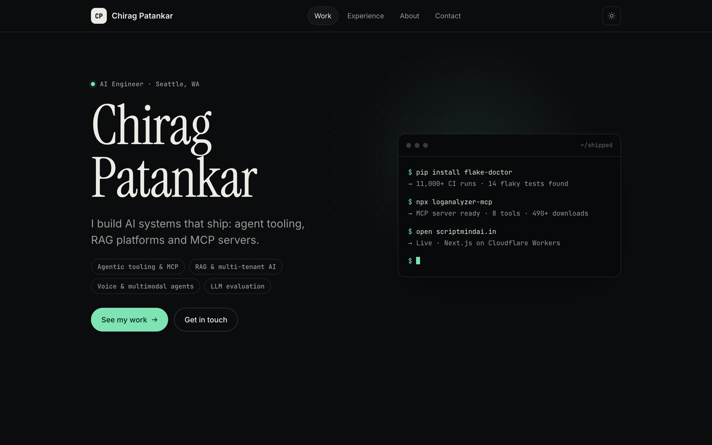
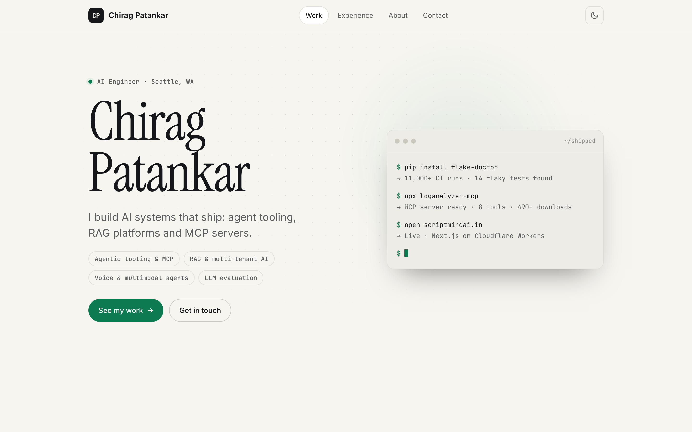
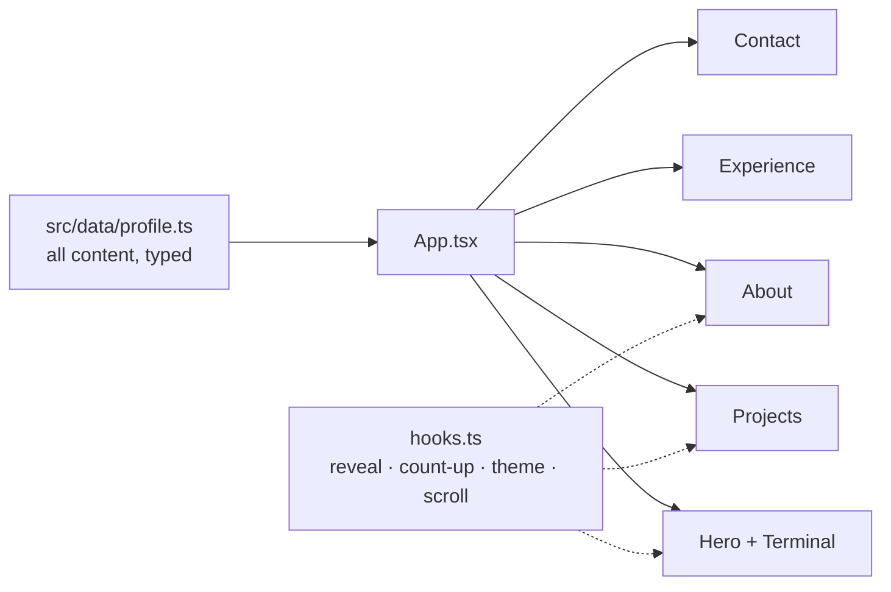

<div align="center">


# Chirag Patankar

**AI Engineer · M.S. in Artificial Intelligence @ Northeastern University, Seattle**

I build AI systems that ship: agent tooling, RAG platforms and MCP servers.

[](https://github.com/ChiragPatankar)
[](https://www.linkedin.com/in/chirag-patankar-67a55a25b/)
[](https://huggingface.co/ChiragPatankar)
[](mailto:officialchiragp1605@gmail.com)

<br>


</div>

---

## 👀 Preview

<picture>
  <source media="(prefers-color-scheme: dark)" srcset="docs/screenshot-dark.png">
  <source media="(prefers-color-scheme: light)" srcset="docs/screenshot-light.png">
  
</picture>

<sub>This screenshot follows your GitHub theme. Switch between light and dark to see both versions of the site.</sub>

<details>
<summary><b>🌗 Show both themes side by side</b></summary>
<br>

| Dark | Light |
|---|---|
|  |  |

</details>

---

## 🧭 Contents

- [Featured work](#-featured-work)
- [What's inside the site](#-whats-inside-the-site)
- [How it's built](#-how-its-built)
- [Run it locally](#-run-it-locally)
- [Edit the content](#%EF%B8%8F-edit-the-content)
- [Deploy](#-deploy)

---

## ⭐ Featured work

Click a project to expand it.

<details>
<summary><b>🩺 flake-doctor</b>: finds, diagnoses and verifies fixes for flaky pytest tests</summary>
<br>

Mines a repo's GitHub Actions history for tests that failed, then passed on the same commit, then diagnoses the cause locally: order dependence, state-leaking tests, real clocks, unseeded randomness.

| CI runs analysed | Flaky tests flagged | False positives on fastapi |
|:---:|:---:|:---:|
| **11,000+** | **14** | **0** |

- Root-caused a pydantic test that fails only when CI crosses midnight UTC
- Ships as a CLI, a GitHub Action and a Claude Code plugin

[Code](https://github.com/ChiragPatankar/Flake-doctor) · [PyPI](https://pypi.org/project/flake-doctor/) · [Marketplace](https://github.com/marketplace/actions/flake-doctor-flaky-test-report)
</details>

<details>
<summary><b>🔎 LogAnalyzer MCP</b>: an MCP server that debugs your logs from inside Claude or Cursor</summary>
<br>

| npm downloads | MCP tools | Average full analysis |
|:---:|:---:|:---:|
| **490+** | **8** | **7.5 s** |

- Parses Node/V8, Java and Python stack traces; watches log files live
- Switchable Gemini / Claude backends with a local fallback when no API key is set

[Code](https://github.com/ChiragPatankar/loganalyzer-mcp) · [npm](https://www.npmjs.com/package/loganalyzer-mcp) · [Cursor Directory](https://cursor.directory/mcp/loganalyzer-mcp-server)
</details>

<details>
<summary><b>🎬 ScriptMind AI</b>: a GenAI studio for screenwriters and producers</summary>
<br>

Beat and dialogue generation, screenplay analysis, AI poster art and a finance studio, with multi-tenant isolation through Postgres row-level security. Built with Next.js 14, Supabase and Cloudflare Workers.

[Live](https://scriptmindai.in) · [Code](https://github.com/ChiragPatankar/scriptmind-ai)
</details>

<details>
<summary><b>💬 ClientSphere</b>: multi-tenant RAG chatbot and CRM platform</summary>
<br>

Businesses upload documents and get an embeddable chat widget grounded in them, plus analytics and admin dashboards.

[Live](https://mcp-5wk.pages.dev/) · [Code](https://github.com/ChiragPatankar/MCP)
</details>

<details>
<summary><b>🌊 TRUSTLINE: ABYSS</b>: a game about knowing when to trust your AI teammate</summary>
<br>

Defense Tech Jam Seattle 2026. Players command a submarine with an AI that is sometimes confidently wrong, and the game scores whether their trust follows the evidence. Built with Three.js and Web Audio.

[Code](https://github.com/ChiragPatankar/Defense-tech-jam)
</details>

<details>
<summary><b>🧩 Image Mosaic Generator</b>: vectorized photomosaics, measured against a baseline</summary>
<br>

| Speed-up vs pure Python | SSIM at viewing distance |
|:---:|:---:|
| **435×** | **0.910** |

[Code](https://github.com/ChiragPatankar/Interactive-Image-Mosaic-Generator)
</details>

---

## 🗂 What's inside the site

| Section | What it shows | Interactions |
|---|---|---|
| **Hero** | Name, tagline, focus areas | Letter-by-letter entrance, a terminal that types itself |
| **Work** | 6 featured projects + 9 more | Category filters, cursor spotlight on cards, metrics that count up |
| **Experience** | Roles and education timeline | Current roles highlighted |
| **About** | Bio, photo, achievements, skills | Scroll-triggered reveals |
| **Contact** | Email and socials | One-click copy email |

<details>
<summary><b>♿ Accessibility and performance details</b></summary>
<br>

- Respects `prefers-reduced-motion`: animations are turned off and numbers show their final values
- The typing terminal gives screen readers its full text immediately
- A skip link, visible focus styles, and tap targets of at least 40 px on mobile
- Light and dark themes, which follow your system setting and are remembered after you toggle
- No UI framework: about 79 KB of gzipped JS and 4 KB of CSS

</details>

---

## 🛠 How it's built




<details>
<summary><b>📁 Project structure</b></summary>
<br>

```text
src/
├── data/
│   ├── profile.ts     ← all site content lives here
│   └── types.ts       ← shapes for projects, experience, etc.
├── components/        ← Nav, Hero, Terminal, Projects, Experience, About, Contact
├── hooks.ts           ← useReveal, useCountUp, useTheme, useScrollProgress
└── index.css          ← design tokens, themes, layout and animations
public/headshot.jpg    ← photo in the About section
docs/                  ← images used by this README
```

</details>

---

## 🚀 Run it locally

```bash
git clone https://github.com/ChiragPatankar/my-portfolio.git
cd my-portfolio
npm install
npm run dev        # http://localhost:5173
```

| Command | What it does |
|---|---|
| `npm run dev` | Starts the dev server with hot reload |
| `npm run build` | Type-checks, then builds to `dist/` |
| `npm run preview` | Serves the production build |
| `npm run lint` | Lints with oxlint |

---

## ✏️ Edit the content

Everything on the site comes from **`src/data/profile.ts`**. The data is typed, so TypeScript flags any missing field.

<details>
<summary><b>Add a project</b></summary>
<br>

```ts
{
  slug: 'my-project',
  name: 'My Project',
  tagline: 'One line on what it does.',
  description: 'Two or three sentences.',
  category: 'Agents & MCP', // or 'GenAI Products' | 'ML & Vision' | 'Data & Analytics'
  year: 2026,
  stack: ['Python', 'FastAPI'],
  highlights: ['A concrete result'],
  metrics: [{ value: '40%', label: 'queries automated' }], // optional, counts up on scroll
  links: [{ label: 'Code', href: 'https://github.com/...' }],
  featured: true, // large card; omit to list it under "More projects"
}
```

</details>

<details>
<summary><b>Change the photo</b></summary>
<br>

Replace `public/headshot.jpg` with a square image, or point `photo` in `profile.ts` at a different file. Remove the `photo` line to hide it.

</details>

### Still to add

- [ ] Patent application number and ResearchGate preprint link
- [ ] Deployed link for TRUSTLINE: ABYSS and teammate names
- [ ] Hugging Face Space for the image mosaic
- [ ] Live URL for this site

---

## 🌐 Deploy

The site builds to a static `dist/` folder. One click deploys it:

[](https://vercel.com/new/clone?repository-url=https://github.com/ChiragPatankar/my-portfolio)
[](https://app.netlify.com/start/deploy?repository=https://github.com/ChiragPatankar/my-portfolio)

Cloudflare Pages also works: import the repo, then set the build command to `npm run build` and the output folder to `dist`.

<div align="center">
<br>
<sub>Built by Chirag Patankar in Seattle</sub>
</div>
